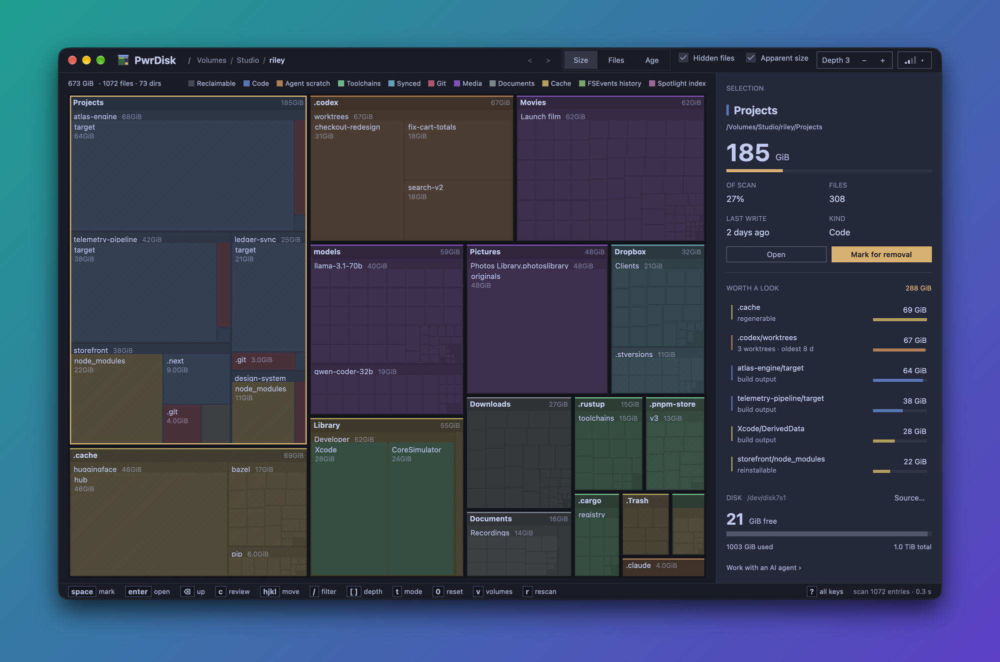

<div align="center">


<h1>PwrDisk</h1>

<strong>See what is filling your disk. Get the space back safely.</strong>

<p>Your whole drive as one map, every folder drawn to its real size.<br>
Mark what should go, review the list, and watch the free space come back.<br>
macOS, Windows and Linux.</p>

<p>
  <a href="https://github.com/pwrdrvr/PwrDisk/releases/latest/download/PwrDisk.dmg"></a>
  <a href="https://github.com/pwrdrvr/PwrDisk/releases/latest/download/PwrDisk-win-Setup.exe"></a>
  <a href="https://github.com/pwrdrvr/PwrDisk/releases/latest/download/PwrDisk-win-arm64-Setup.exe"></a>
</p>

<p>
  <a href="https://github.com/pwrdrvr/PwrDisk/releases/latest/download/pwrdisk-x86_64-linux.tar.gz"></a>
  <a href="https://github.com/pwrdrvr/PwrDisk/releases/latest/download/pwrdisk-aarch64-linux.tar.gz"></a>
</p>

<sub>macOS 11 Big Sur or newer · Windows 10 or newer, x64 and ARM64 · Linux x86-64 and ARM64 · MIT</sub><br>
<sub>Signed and notarized for macOS, signed for Windows, and both keep themselves up to date. No account, no telemetry.</sub>

<br><br>



</div>

## Why PwrDisk

Disks fill up slowly and then all at once. PwrDisk shows you where the space
went in one picture, and gets it back without the "wait, what did I just
delete?" moment.

- **The whole drive at a glance.** Every folder is a tile sized by what it
  really costs on disk, coloured by what it holds: code, caches, toolchains,
  synced files, media, documents. Space you can safely get back — caches,
  build output, package stores — is hatched.
- **Worth a look.** The side panel lists the biggest things that could
  plausibly go, so you don't have to go hunting.
- **Free space, live.** The meter shows the drive's free space now and after
  what you have marked, and only counts what would actually come back to
  that drive.
- **Marking is never deleting.** Mark as much as you like and change your
  mind as often as you like. Nothing happens until you open the review list
  and confirm. The default is the Trash or Recycle Bin; deleting permanently
  always asks first.
- **Guard rails you don't have to think about.** PwrDisk refuses to remove
  system folders, your home folder, mount points or anything outside what you
  scanned. Select a git checkout and it tells you about uncommitted changes,
  stashes and unpushed commits before you mark it.
- **Fast.** A home directory takes seconds. On Windows, run it as
  administrator and it reads a whole NTFS drive straight from the file
  table — about 3.4 seconds for 4 million files.
- **Servers too.** Scan a Linux server over SSH, read-only. PwrDisk never
  deletes over SSH; it hands you the list, or a delete script that checks it
  is on the right machine first.
- **Let an AI agent do the digging.** Claude Code, Codex or any MCP client
  can scan, explain and mark for you. You confirm every removal.

## Install

| Platform | Download | Notes |
| --- | --- | --- |
| macOS 11 or newer | [PwrDisk.dmg](https://github.com/pwrdrvr/PwrDisk/releases/latest/download/PwrDisk.dmg) | Universal: Apple Silicon and Intel. Open it and drag PwrDisk to Applications. |
| Windows 10 / 11, x64 | [PwrDisk-win-Setup.exe](https://github.com/pwrdrvr/PwrDisk/releases/latest/download/PwrDisk-win-Setup.exe) | Installs for you alone, no administrator prompt. |
| Windows 10 / 11, ARM64 | [PwrDisk-win-arm64-Setup.exe](https://github.com/pwrdrvr/PwrDisk/releases/latest/download/PwrDisk-win-arm64-Setup.exe) | The same, for ARM PCs. |
| Windows, for deployment tools | [x64 .msi](https://github.com/pwrdrvr/PwrDisk/releases/latest/download/PwrDisk-win.msi) · [ARM64 .msi](https://github.com/pwrdrvr/PwrDisk/releases/latest/download/PwrDisk-win-arm64.msi) | Installs the same way as Setup.exe. |
| Windows, portable | [x64 .zip](https://github.com/pwrdrvr/PwrDisk/releases/latest/download/PwrDisk-win-Portable.zip) · [ARM64 .zip](https://github.com/pwrdrvr/PwrDisk/releases/latest/download/PwrDisk-win-arm64-Portable.zip) | Runs from wherever you unpack it. |
| Linux, x86-64 | [pwrdisk-x86_64-linux.tar.gz](https://github.com/pwrdrvr/PwrDisk/releases/latest/download/pwrdisk-x86_64-linux.tar.gz) | Unpack and run `./install.sh`. |
| Linux, ARM64 | [pwrdisk-aarch64-linux.tar.gz](https://github.com/pwrdrvr/PwrDisk/releases/latest/download/pwrdisk-aarch64-linux.tar.gz) | The same, for ARM. |

Every release, with checksums, is on the
[releases page](https://github.com/pwrdrvr/PwrDisk/releases).

**macOS.** The app is signed with a Developer ID and notarized by Apple, so it
opens like any other download. To measure everything, give PwrDisk **Full
Disk Access** in System Settings › Privacy & Security (the side panel offers
a button when it is missing), then reopen it. Without it macOS hides Mail,
Messages, Safari, other apps' data and the Trash, and PwrDisk shows them as
unreadable rather than guessing.

**Windows.** Installers are signed by PwrDrvr LLC and land in the Start menu;
uninstall from Settings › Apps. When PwrDisk would be faster or see more as
administrator, the side panel offers **Restart as Administrator**.

**Linux.** No root needed; this installs into `~/.local` with a launcher
entry and an icon. Use `aarch64` in place of `x86_64` on ARM:

```sh
curl -fL https://github.com/pwrdrvr/PwrDisk/releases/latest/download/pwrdisk-x86_64-linux.tar.gz | tar xz
cd pwrdisk-*-x86_64-linux && ./install.sh
```

You need a Wayland or X11 session with a GPU that does Vulkan. On Omarchy
PwrDisk follows your theme; on Hyprland, see
[the window rules](docs/guide.md#on-hyprland).

**Updates.** The Mac app and Windows installs check for a new release when
they start and every six hours, download it in the background, and install
it when you quit (or right away from **Restart to update**). **Shift-U**
shows the version and lets you pick a release channel. The Linux tarball
does not update itself; download the next release.

## Using it

1. **Pick what to scan.** Choose **This computer** or an SSH host, then a
   drive or folder. Nothing is scanned until you choose.
2. **Look around.** Click a tile, or use the arrow keys. Scroll to zoom into
   a folder and keep scrolling to go inside; scroll back to come out.
   **Enter** opens the selected folder, **Backspace** goes up.
3. **Mark what should go.** **Space** marks the tile under the pointer; press
   it again to unmark. The side panel shows how much free space you would
   have afterwards.
4. **Review.** Press **c** to see the list. Unmark anything you are unsure
   of, then **Enter** moves the rest to the Trash or Recycle Bin. **p**
   deletes permanently instead, after asking.
5. **See the result.** PwrDisk scans again and shows how much space you
   actually got back.

| key | does |
| --- | --- |
| `space` | mark or unmark |
| `enter` / `⌫` | open the folder / go up |
| scroll | zoom in, then go inside |
| `/` | filter by name |
| `c` | review what is marked |
| `t` | colour by size, file count or age |
| `g` | scan the whole disk |
| `o` | show in Finder, File Explorer or the file manager |
| `?` | every key |

From a terminal:

```sh
pwrdisk            # choose a source and a folder
pwrdisk ~/src      # scan a folder straight away
pwrdisk --disk     # the whole disk
pwrdisk ssh myserver /var   # a server over SSH, read-only
```

The [user guide](docs/guide.md) covers every screen and key, how sizes are
measured, SSH, and what differs on macOS and Windows.

## With an AI agent

PwrDisk is also an [MCP](https://modelcontextprotocol.io) server. Connect it
after starting PwrDisk and ask your agent what is eating your disk:

```sh
claude mcp add --scope user pwrdisk -- pwrdisk mcp   # Claude Code
codex mcp add pwrdisk -- pwrdisk mcp                 # Codex
```

The desktop must already be running. The command is a transport relay;
the desktop owns tools, schemas, instructions, skills, resources, prompts
and execution. MCP never launches PwrDisk. If the desktop is unavailable,
start it yourself and reconnect MCP in the client. For an independent
scanner, explicitly use `pwrdisk mcp --standalone`; that process owns its
own interface, scans and marks, and cannot remove files or drive a window.

Relative tool paths resolve against the relay's working directory captured
when MCP connects, independently of the desktop's launch directory or scan
root. Initialization metadata (`pathBase`) and status report that fixed
base. `~` refers to the server's home directory. Older relays that supply
no base require absolute paths or `~/…`; reconnect with an updated relay
to enable relative paths. Standalone captures its own working directory.

On macOS the command lives inside the app. The window's **Work with an AI
agent** line, under the disk, shows each command with the full path and a
Copy button.

The agent walks the tree, lists every cache and build directory, and
proposes what can go. You can confirm in PwrDisk's review screen yourself,
or explicitly approve an exact removal preview for the destructive MCP
removal tool. Approval to mark never authorizes removal. Agents must never
approve through computer use. Trash may be recoverable until emptied;
permanent deletion cannot be undone through PwrDisk. Settings > Safety
limits each operation to 5% of each volume's capacity by default. If a PwrDisk window is open, you both look at the
same map and its marks show up as the agent makes them. More in
[the guide](docs/guide.md#with-an-ai-agent).

## What PwrDisk will not delete

Only things inside the folder you scanned can be removed, and never:

- the scanned folder itself, your home folder, or a folder that holds it;
- system folders (`/usr`, `/etc`, `C:\Windows`, Program Files, Homebrew's
  prefix and the like), even where permissions would allow it;
- a mount point, or anything with another disk mounted inside it;
- what a symlink points to (the link is removed, not its target).

Each rule is [tested](crates/disktree-core/src/removal.rs). The full list is
in [the guide](docs/guide.md#what-it-refuses-to-do).

## Thanks, Tobi

PwrDisk began as [disktree](https://github.com/tobi/disktree), written by
[Tobi Lütke](https://github.com/tobi). The idea, the design and most of the
code are his and disktree's contributors', and they deserve the credit.

Tobi also has a day job running Shopify, which we hear keeps him fairly
busy. So we picked disktree up to keep it fed: signed installers that update
themselves, macOS and Windows builds, and the AI agent link. Fixes that make
sense upstream go back to disktree as pull requests.

## Build it yourself

```sh
git clone https://github.com/pwrdrvr/PwrDisk
cd PwrDisk
make install
```

[docs/building.md](docs/building.md) has what each system needs, signing
your own Mac build, and how to work on the code.

## License

MIT. See [LICENSE](LICENSE) and
[THIRD_PARTY_LICENSES](THIRD_PARTY_LICENSES).
